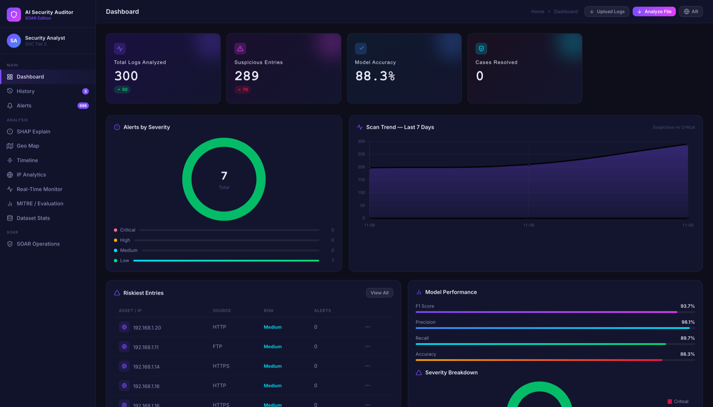
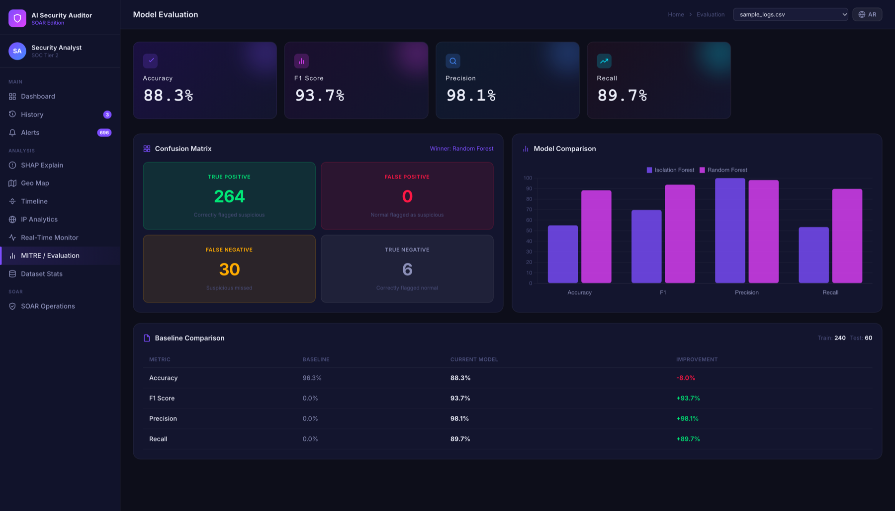
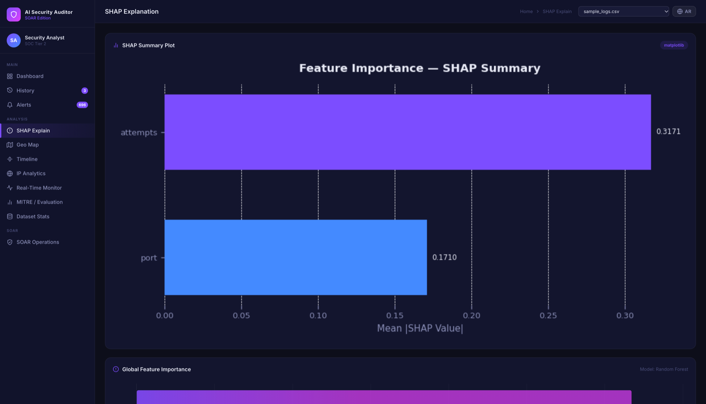
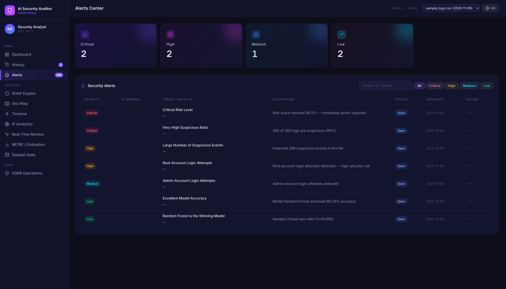
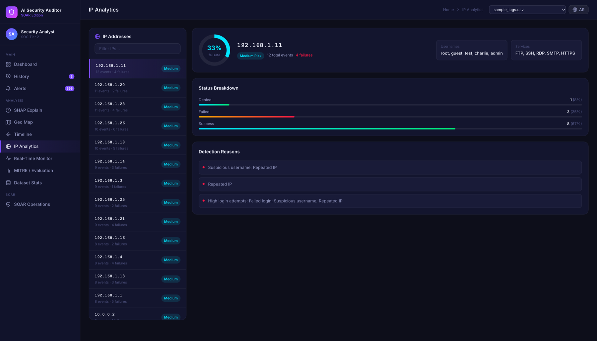
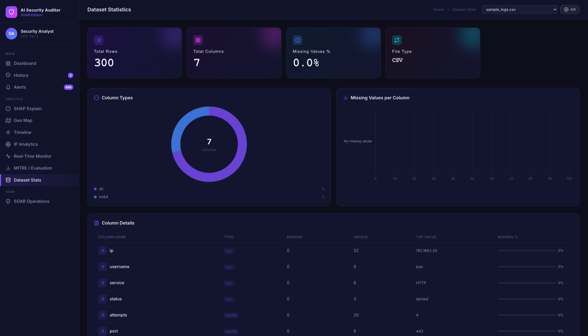
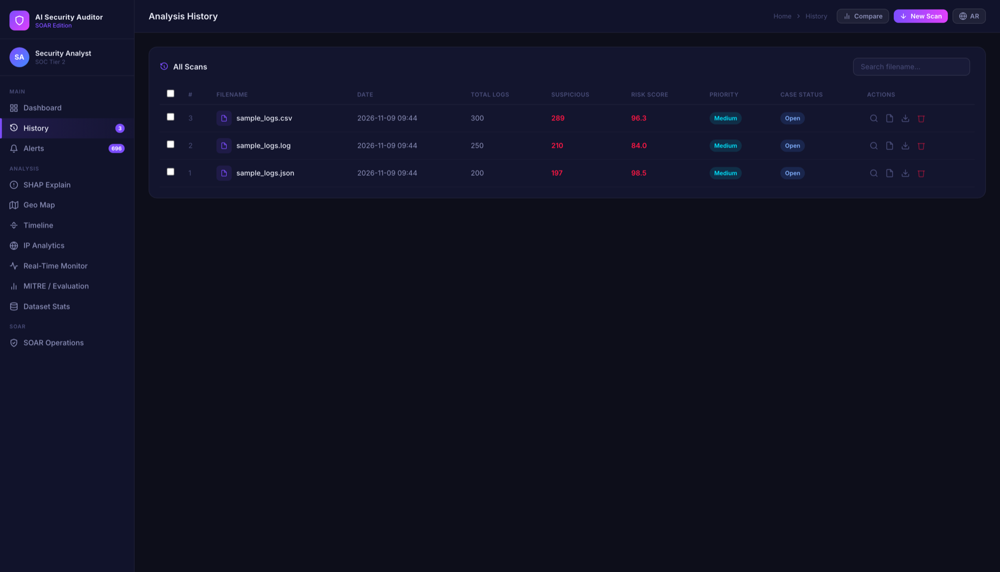
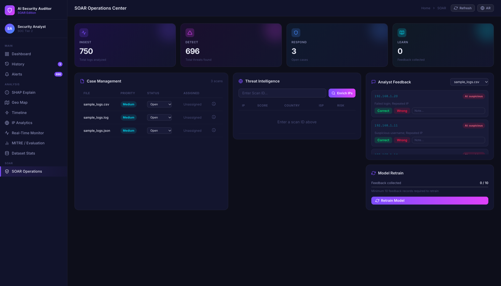

# AI Security Auditor

An explainable, web-based system that analyzes security log files and flags suspicious activity by combining **rule-based detection** with **machine learning**. Every flagged record comes with a reason, and every threat is mapped to the **MITRE ATT&CK** framework.

Built during a 28-week cooperative (COOP) training at JODAYN as a graduation project at the University of Ha'il.

## Why this project

Security servers produce thousands of log entries a day, so reading them by hand does not scale. Signature-based tools miss attack patterns they have not seen before, and many AI tools return a verdict with no explanation. AI Security Auditor addresses all three problems at once: it automates the analysis, uses an anomaly-detection model alongside fixed rules, and explains each decision.

## Features

- **Multi-format ingestion** - upload CSV, JSON, Syslog, LOG or TXT files (up to 16 MB); columns are normalized automatically.
- **Hybrid detection** - four rule-based checks (excessive attempts, failed logins, suspicious usernames, repeated IPs) plus two ML models.
- **Automatic model selection** - Isolation Forest and Random Forest are trained side by side and the better one is chosen by **F1 Score**, not accuracy, because security data is heavily imbalanced.
- **Explainable AI** - SHAP values show which features pushed each record toward "suspicious".
- **MITRE ATT&CK mapping** - detected behavior is linked to techniques such as T1110 (Brute Force) and T1078 (Valid Accounts).
- **Severity-ranked alerts** - Critical, High, Medium and Low, with search and filters.
- **Analytics views** - risk dashboard, timeline, per-IP analytics, dataset statistics, and model evaluation (confusion matrix, model comparison).
- **Geographic map** - attack-source locations via IP geolocation.
- **Real-time monitor** - paste log lines and get instant keyword/rule-based verdicts streamed over WebSocket (no file upload).
- **SOAR workflow** - case status and assignment, analyst feedback (correct / wrong), and model retraining after enough feedback is collected.
- **Reporting** - export results as PDF (with Arabic support) or multi-sheet Excel; compare any two past analyses.

## How it works

```
Upload file
   -> preprocess.py      parse and clean (CSV / JSON / Syslog)
   -> rules_engine.py    4 rule-based checks
   -> ai_model.py        train Isolation Forest + Random Forest, pick best by F1
   -> combined flag      suspicious = rule flag OR AI flag
   -> shap_explainer.py  explain each suspicious record
   -> mitre.py / alerts  map to MITRE ATT&CK and rank by severity
   -> Dashboard, history (SQLite), PDF / Excel export
```

The two detectors are combined with **OR** on purpose: in security, missing a real attack costs far more than reviewing an extra alert.

## Tech stack

| Layer | Technology |
|---|---|
| Language | Python 3.10+ |
| Backend | Flask, Flask-SocketIO (WebSocket) |
| Machine learning | scikit-learn (Isolation Forest, Random Forest), pandas, NumPy |
| Explainability | SHAP, Matplotlib |
| Database | SQLite |
| Reporting | ReportLab (PDF), openpyxl (Excel), arabic-reshaper + python-bidi |
| Frontend | HTML, CSS, JavaScript, Chart.js, Socket.IO client |

## Results

Measured on the bundled sample dataset (`data/sample_logs.csv`, 300 records, 80/20 stratified split, fixed random seed):

| Model | Accuracy | F1 Score |
|---|---|---|
| Isolation Forest | 55.0% | 69.7% |
| **Random Forest (selected)** | **88.3%** | **93.7%** |

Selected model: precision 98.1%, recall 89.7%.

Testing: **20/20** documented functional test cases passed (upload formats, detection rules, model selection, SHAP, MITRE mapping, alerts, exports, real-time monitor, history, rate limiting, batch analysis), plus **11 automated unit tests** (see below).

> These figures come from a small, synthetic sample set intended to validate the pipeline end to end. See *Limitations*.

## Getting started

```bash
# 1. Clone and enter the project
git clone https://github.com/layan000912/Ai-security-Auditor.git
cd Ai-security-Auditor

# 2. Create a virtual environment and install dependencies
python3 -m venv .venv
source .venv/bin/activate          # Windows: .venv\Scripts\activate
pip install -r requirements.txt

# 3. (Optional) configure settings
cp .env.example .env               # then edit .env

# 4. Run
python app.py
```

Open <http://localhost:5000> and upload `data/sample_logs.csv` (or the `.json` / `.log` samples) to try it.

> On macOS, port 5000 is often taken by AirPlay Receiver. If you see a 403 or a blank page, run on another port, e.g. `PORT=5001 python app.py`, and open that port instead.

### Configuration

Settings are read from environment variables or a local `.env` file (never committed):

| Variable | Default | Purpose |
|---|---|---|
| `SECRET_KEY` | random per start | Flask session signing key |
| `PORT` | `5000` | Port the server listens on |
| `FLASK_DEBUG` | `0` (off) | Debug mode - for local development only |
| `CORS_ORIGINS` | `http://localhost:<PORT>,http://127.0.0.1:<PORT>` | Allowed WebSocket origins |
| `TRUST_PROXY` | `0` | Set to `1` behind a reverse proxy to read `X-Forwarded-For` |
| `ABUSEIPDB_API_KEY` | empty | Optional; without it the threat-intelligence panel shows mock data |

## Running the tests

```bash
pip install pytest
python -m pytest test_system.py -v
```

## Screenshots

| Dashboard | Model evaluation |
|---|---|
|  |  |
| **SHAP explanation** | **Alerts center** |
|  |  |
| **IP analytics** | **Dataset statistics** |
|  |  |
| **Analysis history** | **SOAR operations center** |
|  |  |

*Screenshots were taken after analyzing the bundled sample files; the dashboard, evaluation, SHAP, alerts, IP and dataset pages show `sample_logs.csv`, the same dataset as the Results section.*

## Project structure

```
app.py                  Flask + SocketIO entry point and API routes
models/
  preprocess.py         file type detection, parsing, cleaning
  rules_engine.py       rule-based detection
  ai_model.py           Isolation Forest + Random Forest, F1-based selection
  shap_explainer.py     SHAP explanations and charts
utils/                  database, alerts, MITRE mapping, GeoIP, threat intel,
                        feedback/retraining, PDF and Excel export
templates/              HTML pages (dashboard, history, alerts, SHAP, map, ...)
static/                 CSS and JavaScript
data/                   sample log files (the SQLite database is created on first run)
test_system.py          unit tests
```

## Limitations and future work

- The Random Forest is trained on the rule engine's own flags, so it learns to generalize the rules; Isolation Forest is the component that can surface genuinely new anomalies.
- Results are from a small synthetic dataset; a real deployment should retrain on the organization's own traffic.
- Single-user: there is no authentication or role-based access control yet, and SQLite is not designed for many concurrent writers.
- Planned: authentication and roles, SIEM integration (Splunk / Elastic), sequence models (LSTM) for temporal patterns, and automated response actions.

## Author

Layan Ayad Alshammari - College of Computer Science and Engineering, University of Ha'il. COOP training at JODAYN (Innovation Department).
